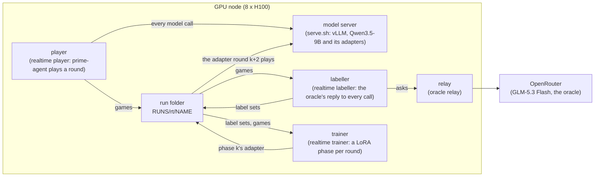

# How a run works

What runs where, what each process does and what a run leaves on disk. What each module does is in
[the code](code.md), why each setting is what it is in [settings](settings.md), and every term in the
[glossary](glossary.md).

## The picture

A trained row runs on one GPU node. Its model server, its three loops and the oracle's relay all run there, and the
run writes everything into one folder on the node's disk.



The reference rows need no GPU: `references` plays them with the model served by OpenRouter, on any machine that runs
prime-agent.

## What a node needs

- **This repository**, cloned anywhere (the examples assume `~/continual-arc`). Every script finds what it needs from
  where it sits: this package is `training/`, the benchmark the repository root and the baselines `baselines/`. Set
  `BASELINES` to use another baselines checkout.
- **prime-rl** at commit `a1822f7`, checked out at `PRIME_RL` (default `~/prime-rl`). Its environment runs the player,
  the labeller and the trainer (`uv run --no-sync` from that checkout) and pins torch 2.13.0, Triton 3.7.1,
  flash-linear-attention 0.5.2, tilelang 0.1.12 and transformers 5.6.2 ([settings](settings.md#the-software-stack)).
  Install into it peft, the benchmark, the baselines and this package, all editable from the checkout:
  `uv pip install --python ~/prime-rl/.venv/bin/python -e ~/continual-arc -e ~/continual-arc/baselines -e ~/continual-arc/training peft`.
- **vLLM 0.30.0** in an environment of its own, at `VLLM_VENV` (default `~/vllm-0.30.0`), which `vllm-serve.sh`
  installs the first time it runs.
- **prime-agent 0.9.6**, the harness every row plays in, with bubblewrap for its sandbox, which needs unprivileged user
  namespaces (`sudo sysctl -w kernel.apparmor_restrict_unprivileged_userns=0` on Ubuntu: `frozen.sh` sets it itself,
  `realtime.sh` and `paper.sh` expect it set).
- **The base model**, `Qwen/Qwen3.5-9B`, in the node's Hugging Face cache: the loops run with `HF_HUB_OFFLINE=1`, since
  several data-parallel workers starting at once, each asking the hub for the model, are refused its files.
- **An OpenRouter key** for the oracle (DAgger and OPSD) and the reference rows: `OPENROUTER_API_KEY` in the
  environment, or in `BASELINES/.env`. The relay holds it, so the loops never do.
- **`RUNS`** (default `~/runs`), where every run writes: `RUNS/rt/NAME` for a trained run, `RUNS/paper/NAME` for a
  reference row or a `paper.sh` row, `RUNS/loop` for the model server's files, `RUNS/gpupool` for the trainers' shared
  GPUs.

## The trained rows: a fixed one-round lag

`realtime.sh` runs DAgger, OPSD or PG (`ROW`) on `arc1-small` served to `USERS` users (1, 2 or 4 of the benchmark's
canonical 1, 2, 4, 8 and 16): the stream's 200 rounds (`ROUNDS`), then the two frozen tests. Round r is always played
by the model trained on rounds 0..r-1-LAG (`LAG=1`; `LAG=0` is the strict, synchronous protocol): play waits for that
model when training is behind, and training never waits for play, so the hardware decides how long a run takes but
never which model plays which round. With a lag of 1 the one difference from the strict protocol is the round just
played: a returning visit that comes straight after its task's previous visit is played before the weights have
learnt from that visit, though prime-agent's memory, updated at once, holds what it saved.

```bash
ROW=dagger USERS=1 LR=1e-4 START_AFTER=24 SERVE_GPUS=0,1,2,3 SERVE_DP=1 TRAIN_GPUS=4,5,6,7 \
    setsid nohup bash ~/continual-arc/training/scripts/realtime.sh > /dev/null 2>&1 < /dev/null &
```

A run is named `ROW-uUSERS-lagLAG`. The driver's loops (`python -m continual_arc_training.realtime player|labeller|trainer`)
run side by side and hand each other files, each restarted by `realtime.sh` when it dies (up to `MAX_RESTARTS`, 5) and
each resuming from its files. `realtime.sh` also keeps the oracle's relay and the model server up, starting either
again within a pass when it is found down.

- **player:** round r on phase r-1-LAG's adapter (the base model before there is one, or when that phase trained
  nothing), waited for until the trainer has finished it, loaded into the model server, which stays up on its own GPUs
  (`SERVE_GPUS`), and checked: vLLM silently serves the base model under an adapter's name when the adapter's layers
  are misnamed, so the player sends a fixed prompt to both at temperature 0 and stops rather than play a round on an
  adapter that answers exactly as the base model does (`server.check_served_adapter`). `rounds/rNNNN/served.json`
  records the phase, the rounds it trained on and the lag. A round is played through the benchmark's runner by the
  baselines' `CollectiveHarnessLearner`, every user's prime-agent behind a proxy that asks vLLM for the token ids, and
  every game is saved as it ends, calls and ids whole, in the round's `captured/`.
- **labeller** (DAgger and OPSD): the oracle (GLM-5.3 Flash at medium effort, through the relay) writes its own reply
  to every call the student made as the agent, each read exactly as the student read it with the oracle's working
  rules at the end of its last message, its reasoning required (`labeller`, `oracle`). The rules are `ORACLE_RULES`'s:
  the playing rules, c1 (`rules/c1.md`), and the program library's procedure (`library`, the default), or c1 alone
  (`c1`). The student never reads them. The run's `guidelines.md` keeps them, and a labeller started again under
  other rules stops before it labels, rather than change the oracle mid-run. A game is labelled as it lands and the
  round once more when it is played. Then the label set, each label as the student writes it (DAgger's target), and
  its split, one game in `HOLD_EVERY` (10) held out (`labeller.held_game`). A held-out game is played and scored like
  any other; only its labels go to the held-out side. OPSD trains on DAgger's own label sets.
- **trainer:** phase k starts once round k is ready (labelled; for PG, played), from phase k-1's adapter, into
  `train/pNNNN` (`train/latest.json` names the newest). It is trained by a `train` process that holds the model on the
  GPUs the node's pool gives the run (`TRAIN_GPUS`), so the model loads once for as long as the run keeps those GPUs.
  While rounds 0..k hold fewer than `START_AFTER` games (every user's), a phase trains nothing, saves no adapter and
  takes no GPU, and the base model plays its round. Every row's phase is one setup, `phase.fit`, and only its update is
  the row's own (`updates.Imitation`, `updates.SelfDistillation`, `updates.PolicyGradient`): the dose, the held-out
  games, the held-out stop, the step plan (`phase.plan`: every pass drawn before the first step, whole chains of a
  game's calls cut to fit a GPU's window), the settings and the checkpoints are one configuration for all three
  (`realtime.train_args`). The held-out loss is measured before the first step and every `EVAL_STEPS` (5) steps, the
  best adapter is kept, and the phase stops once `PATIENCE` (2) measurements in a row have not improved on it, or at
  `MAX_STEPS` (120); until a held-out game exists, a phase makes one pass.
  - **DAgger:** supervised fine-tuning on the dose's labels (`DOSE=aggregate`: every round's training side so far),
    the oracle's reply, reasoning included, the target. Its held-out loss is the held-out targets' negative
    log-likelihood per token. `DOSE=recent` trains each phase on the last 10 rounds' labels and as many from whole
    earlier games drawn at random, under the same stop.
  - **OPSD:** DAgger's phase with SDFT's loss: the same label sets' calls in the same steps, the same held-out games,
    passes and stop. At each call the current student's own reply is drawn fresh from the model server, to which the
    student is published after every step, and graded by the frozen base model reading the call's label as a
    demonstration: the forward KL over the full vocabulary, the first `SKIP_FIRST` (3) ids ungraded, each reply
    weighing alike. Its held-out loss is that loss over the held-out games' replies as they were played.
  - **PG:** REINFORCE with no baseline on every game so far but the held-out ones (`updates.pg_items`: a win's reward
    1, a failure's 0, so a failure pushes nothing), every ratio clipped against the adapter that played the round,
    whose reply log-probabilities are taken once, while that adapter is still on disk, and kept in the round's
    `pg_behaviour.json.gz`. The surrogate is dual-clipped: a token of negative advantage past a ratio of 3 gives no
    gradient. Each step's line in `phase.json` keeps `dual_clip_fraction` and `log_ratio_worst`, the step's token of
    largest |log r| with its call, position, id and both log-probabilities. PG's held-out loss is its own loss over
    the held-out games, which reads only their wins, so its stop runs once a held-out game has won.

`realtime.sh`'s `started:` line in the run's `progress` records every setting the run was started with, so a run can
be started again with the same ones.

### Runs that share a node

One server on the same `SERVE_GPUS` serves every run on the node, and runs given the same `TRAIN_GPUS` share them as
one **pool** (`gpupool`); runs may instead have `TRAIN_GPUS` of their own (lists that overlap but differ are refused).
A run's trainer needs GPUs only while it trains a phase and waits the rest of the time for its rounds' labels and play,
so the pool gives its GPUs to whichever runs have a phase to train: each such run an even share, a phase in flight
giving GPUs up to another run's phase at its next step checkpoint and going on from it on its new share, and taking
more only when its next phase starts. A phase's steps never depend on how many GPUs train it (a piece of a chain holds
at most `CHAIN_CALLS`, 16, calls, and a checkpoint's fingerprint leaves the GPUs out), so it resumes on any number of
them. OPSD's draws slow every other run's calls on its server.

### A round or a phase cut short

A round cut short (a restart, a node stopped) is played again from its start, all its games anew (the runner records
only whole rounds), and labelled anew: each label is kept under its call's own id (`labeller.point_id`), so none made
for a game the replay discarded is read for the new game's call. A phase cut short goes on from its last step
checkpoint (`checkpoints`: one on SIGTERM, a preemptible machine's notice, and one every 25 steps), on the same
batches in the same order, from the same random state; a phase stopped before its first checkpoint trains again from
its start.

## The frozen tests

After the stream's 200 rounds the system is tested twice, frozen, both tests played at once: the **held-out test**, one
instance of each of the 100 held-out tasks (ARC-AGI-1 evaluation tasks the stream never uses), and the **seen test**,
four new instances of each of the stream's 25 tasks at one user. At several users each user brings tasks of their own
(user k block k of the benchmark's nested task order, `configs.user_tasks`), and the seen test covers all of them: two
new instances of each of 50 tasks at two users, one of each of 100 at four, one of every task at eight and sixteen.
The benchmark defines both (`configs.test_schedule`); those for `arc1-small` at seed 0 are in
`src/continual_arc_training/schedules/`, the seen test's one for each number of users, and `frozen.sh` plays a run's
own. Each is one round, every instance a user of its own starting from the end-of-stream state, so nothing one test
instance does reaches another and nothing is learnt.
Transfer, the benchmark's headline, is the budget a run saves on the held-out test against the learner reset on the
same instances (row H0).

`frozen.sh RUN GPUS` plays a trained run's tests on its own node once its stream has ended. The model is the run's last
phase, served on half of GPUS for each test by a server of its own on a port of its own (8120 plus its first GPU),
launched as `serve.sh` launches the stream's. Test user i's harness memory is stream user i mod U's at the end of the
stream, with every absolute path that named the stream user's folder renamed to the test user's: a prime-agent state
names its folder in its Python environments, its daemon's records, its sessions and its SQLite databases' rows, and a
state that kept them would read and write the stream user's own files. A run whose learner committed every user's
state round by round (a state log) has each test user forked from its stream user's commit of the stream's last round
by the baselines' own seeding, so `git diff HEAD~1 HEAD` in a test user's `system/state.git` is what it wrote in its
test instance; a run without one has its users' states copied and renamed. Each test is a benchmark run of its own,
`RUNS/rt/RUN/frozen/held-out/play` and `frozen/seen/play`, with `frozen/summary.json` beside them; once it is recorded,
its users' copies of the memory go (the memory itself is the run's) and every call, turn and game of the test stays.

**The trained rows' references** on the same stack, rows h0 and bare from nothing, both tests, are played by `refs.sh`
on a trained run's node once its own tests are done (`frozen.sh` with `ROW`), into
`RUNS/paper/qwen-h0/frozen/TEST-reference/play` and `RUNS/paper/qwen-f/frozen/TEST-reference/play`. `paper.sh` plays the
same two rows over the held-out instances alone (`EPILOGUE=1 EPILOGUE_USERS=4 WIDTH=100 ROUNDS=4`): the held-out test's
instances are user 0's of the schedule's epilogue, and neither row carries anything from one instance to the next.

**The weights alone and training once at the end.** `scratch.sh RUN` runs on a DAgger run's node once every run there
and its frozen tests are done. It plays the run's phase 199 on both tests from an empty memory under the run's own task
names, its weights alone (`frozen.sh` with `MEMORY=none`, into `scratch/weights`). Then it trains DAgger's phase 199
once more from the base model, on the same label sets and held-out games, loss, learning rate, batch and patience, the
held-out loss measured every 25 steps with no step cap and at most 720 minutes (`scratch`), plays the fresh adapter on
both tests from the run's end-of-stream memory (into `scratch/frozen`), and compares both adapters instance by instance
in `scratch/summary.json`.

## The reference rows

The reference rows (H, H0, HPL, HG, HA, HPL0, HPLG, HGPL and the bare-model rows DC, F, M and M0) are played by
`references`, kept going by `reference.sh`, exactly as `play.play_round` plays a trained row's round (the same stream
cut a round at a time, the same harness with its compaction point and call budget, the same 131,072-token window and
32,768-token replies), but with the model served by OpenRouter: GLM-5.3 Flash (the trained rows' oracle) or Qwen3.5-9B
(their base model, untrained).

```bash
PLAYER=glm ROW=h USERS=1 setsid nohup bash ~/continual-arc/training/scripts/reference.sh > /dev/null 2>&1 < /dev/null &
```

`ref-tests.sh` then plays each finished reference row's two frozen tests, from its end-of-stream memory, with the row's
own player. A wiped row or a floor at one user (h0, hpl0, m0, f) plays both tests a second time from an empty state
(`frozen play --reference`, into `frozen/TEST-reference/play`), a second, independent play, so that the spread of
playing a test twice can be read. GLM's row h at 1, 2 and 4 users is tested again with Qwen playing from GLM's memory
(`frozen/TEST-qwen/play`).

## The frozen rows round by round

`paper.sh` plays row H0 or the bare model (`ROW=h0` or `bare`) round by round on the node's own vLLM with no lag: serve
the base model, play round r, write the round's memory counters to the progress log. Every stage is marked, so a kill
at any step resumes there. H0 is played in the harness's `stateless` mode, its state wiped before every instance.
`USERS=N` serves the stream to N users, the whole schedule's first N, under names of their own; `ROW=h0 USERS=4
ROUNDS=3` is a smoke test of a node's stack.

## Reading a run

- **`progress` is the diary.** Every run folder has a `progress` file, one time-stamped line per event, the script's
  `started:` line first.
- **Every stage leaves a marker.** `play.done` in a round's folder, `labels/split/split.json` for its labels, `DONE` and
  `rounds.json` in a phase's folder, `player.done`, `labeller.done` and `trainer.done` for a loop, `frozen/done` for the
  tests. Running the same command again skips what is done.
- **Users are slots.** A user (`u000`, `u001`, ...) plays one instance a round, keeping its own harness memory from
  round to round in `play/users/uNNN/`.
- **A trained run's folder:** `play/` is one benchmark run (`records.jsonl`, `schedule.json`, `meta.json`,
  `summary.json`, `driver.json`), so `continual-arc report` reads it as any other. `play/rounds/rNNNN/` holds the
  round's games as served (`captured/`), `served.json`, `memory.json` (the users' memory diffed against the round
  before) and `labels/`. `train/pNNNN/` holds each phase's `adapter/`, `DONE`, `phase.json` (one line a step and every
  held-out measurement) and `rounds.json`; `train/kernels.json` the software the phases trained on. Older phases are
  pruned to their records, every 20th phase's adapter kept. `frozen/` holds the two tests.

## Rows at a glance

| Row | Script | Weights | Harness memory |
| --- | --- | --- | --- |
| H0 | `reference.sh`, `paper.sh`, `refs.sh` | Frozen | Wiped before every instance |
| H | `reference.sh` | Frozen | Kept (prime-agent's own) |
| PG | `realtime.sh` | Trained with a one-round lag: REINFORCE on the won games, clipped against the adapter that played them | Kept |
| OPSD | `realtime.sh` | Trained with a one-round lag: SDFT toward the frozen base model reading the oracle's label as a demonstration, on the student's fresh replies | Kept |
| DAgger | `realtime.sh` | Trained with a one-round lag: supervised fine-tuning on the oracle's own reply to each call, reasoning included | Kept |
