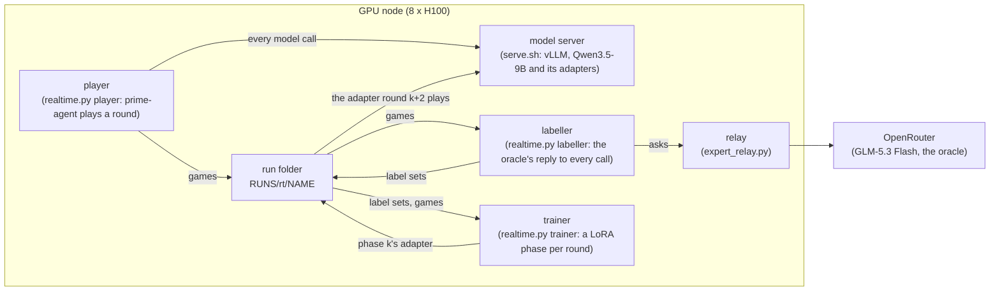

# How a run works

This page explains how the scripts in this folder run the paper's rows: what runs where, what each process does and
what a run leaves on disk. For what each file does, see [What each file does](code.md); for how the settings were
chosen, see [The training-method search](method-search.md); for a word, see the [glossary](glossary.md).

## The picture

A trained row runs on one GPU node. Its model server, its three loops and the oracle's relay all run there, and the
run writes everything into one folder on the node's disk.



Reference rows need no GPU: `reference.py` plays them with the model served by OpenRouter, on any machine that can run
prime-agent.

## What a node needs

Machine provisioning is not part of this folder: unify rented its nodes (8 x H100, mostly preemptible) and set them up
with scripts of its own, which stay private. A node that runs these scripts needs:

- **This repository**, cloned anywhere (the examples assume `~/continual-arc`). Every script finds the folders it needs
  from where it sits: this folder is `training/`, the benchmark is the repository root (`..`) and the baselines are
  `../baselines`. Set `BASELINES` to use another baselines checkout.
- **prime-rl** at commit `a1822f7`, checked out at `PRIME_RL` (default `~/prime-rl`), whose environment runs the player,
  the labeller and the trainer (`uv run --no-sync` from that checkout). It pins torch 2.13.0, Triton 3.7.1, fla 0.5.2,
  tilelang 0.1.12 and transformers 5.6.2 ([fla-hopper-gradients.md](fla-hopper-gradients.md)). Install into it the
  benchmark (`..`), the baselines (`../baselines`), `ask_sd` and peft.
- **`ask_sd`**, unify's trainer package (`Trainer`, `calls`, `server`, `thoughts`, `parallel`), which `train.py`,
  `realtime.py` and `paper.py` import. It is not in this repository.
- **vLLM 0.30.0** in an environment of its own, at `VLLM_VENV` (default `~/vllm-0.30.0`), which `vllm-serve.sh`
  installs the first time it runs.
- **prime-agent 0.9.6**, the harness every row plays in, with bubblewrap for its sandbox, which needs unprivileged user
  namespaces (`sudo sysctl -w kernel.apparmor_restrict_unprivileged_userns=0` on Ubuntu: `frozen.sh` and
  `grid-vals.sh` set it themselves, `realtime.sh` and `paper.sh` expect it set).
- **The base model**, `Qwen/Qwen3.5-9B`, in the node's Hugging Face cache: the trainer runs with `HF_HUB_OFFLINE=1`,
  since several workers starting at once and each asking the hub for the model were refused its files.
- **An OpenRouter key** for the oracle (DAgger and OPSD) and the reference rows: `OPENROUTER_API_KEY` in the
  environment, or in `BASELINES/.env`. The relay holds it, so the loops never do.
- **`RUNS`** (default `~/runs`), where every run writes: `RUNS/rt/NAME` for a trained run, `RUNS/paper/NAME` for a
  reference row or a `paper.sh` row, `RUNS/loop` for the model server's files.

## The trained rows run with a fixed one-round lag

`realtime.sh` runs DAgger, OPSD or PG (`ROW`) on `arc1-small` served to `USERS` users (1, 2 or 4 of the benchmark's
canonical 1, 2, 4, 8 and 16): the stream's 200 rounds, then the two frozen tests (below). Round r is always played by
the model trained on rounds 0..r-1-LAG (`LAG=1`; `LAG=0` is the strict, synchronous protocol): play waits for that
model when training is behind, and training never waits for play, so the hardware decides how long a run takes but
never which model plays which round. With a lag of 1 the one difference from the strict protocol is the round just
played: a returning visit that comes straight after its task's previous visit (in workstreams order, 19% of returning
visits at 1 user and 19-22% at 2 and 4) is played before the weights have learnt from that visit, though prime-agent's
memory, updated at once, holds its saved program.

The paper's runs were started with these settings, all else at `realtime.sh`'s defaults:

```bash
ROW=dagger USERS=1 LR=1e-4 START_AFTER=24 SERVE_GPUS=0,1,2,3 SERVE_DP=1 TRAIN_GPUS=4,5,6,7 \
    setsid nohup bash ~/continual-arc/training/realtime.sh > /dev/null 2>&1 < /dev/null &
```

`ROW` is `dagger`, `opsd` or `pg` and `USERS` 1, 2 or 4, nine runs named `ROW-uUSERS-lag1`, on eight nodes: each run on
a node of its own, serving on GPUs 0-3 and training on 4-7, but for DAgger and PG at one user, which shared one node and
its server and trained on GPUs 4-5 and 6-7. The three DAgger runs were restarted with `DOSE=recent PATIENCE=4` from
phase 94 at one user, 89 at two and 69 at four ([method-search.md](method-search.md), "Why DAgger's phases stop").
OPSD at two and four users was stopped after rounds 33 and 26 ([method-search.md](method-search.md), "Why OPSD does
not learn").

On one node, `realtime.py`'s loops run side by side and hand each other files, each restarted by `realtime.sh` when it
dies and each resuming from its files:

- **player:** round r on phase r-1-LAG's adapter (the base model before there is one), waited for until the trainer
  has finished it, loaded into the model server, which stays up on its own GPUs (`SERVE_GPUS`), and checked: vLLM
  silently serves the base model under an adapter's name when the adapter's layers are misnamed, so the player sends a
  fixed prompt to both at temperature 0 and refuses a round on an adapter that answers as the base model does.
  `rounds/rNNNN/served.json` records the phase, the rounds it trained on and the lag.
- **labeller** (DAgger and OPSD): the oracle (GLM-5.3 Flash at medium effort, through `expert_relay.py`) writes its
  own reply to every player call, each read exactly as the player read it with the oracle's working rules at the end
  of its last message, its reasoning required. The rules are `ORACLE_RULES`'s (`oracle_hint.oracle_rules`): the
  playing rules, c1 ([rules/c1.md](../rules/c1.md)), and the program library's procedure (`library`, the default and
  the paper's), or c1 alone (`c1`). The student never reads them. The run's `guidelines.md` keeps them, and a labeller
  started again under other rules stops before it labels, rather than change the oracle mid-run. A game is labelled as
  it lands and the round once more when it is played. Then the label set (each label as the student writes it, the
  DAgger row's target) and its split, one game in `HOLD_EVERY` (10) held out (`forward.held_game`), played and scored
  like any other: DAgger's and OPSD's alike, so OPSD trains on DAgger's own label sets.
- **trainer:** phase k starts once round k is ready (labelled; for PG, played), from phase k-1's adapter, into
  `train/pNNNN` (`train/latest.json` names the newest), trained by a `train` process that holds the model on the GPUs
  the node's pool gives the run (`TRAIN_GPUS`), so the model loads once for as long as the run keeps those GPUs. While
  rounds 0..k hold fewer than `START_AFTER` games (every user's), a phase trains nothing, saves no adapter and takes no
  GPU, and the base model plays its round. Every row's phase is one setup, `train.fit`, and only its update is the
  row's own (`train.Imitation`, `train.SelfDistillation`, `train.PolicyGradient`): the dose, the held-out games, the
  held-out stop, the step plan (`train.plan`: every pass drawn before the first step, whole chains of a game's calls
  cut to fit each GPU), the settings and the checkpoints are one configuration for all three (`realtime.train_args`).
  The held-out loss is measured before the first step and every `EVAL_STEPS` (5) steps, the best adapter is kept, and
  the phase stops once `PATIENCE` (2) measurements in a row have not improved on it, or at `MAX_STEPS` (120); until a
  held-out game exists, a phase makes one pass.
  - **DAgger:** supervised fine-tuning on every round's training side so far (`DOSE=aggregate`, DAgger's aggregate,
    uniform), the oracle's reply, reasoning included, the target; its held-out loss is the held-out sides' targets'
    likelihood. `DOSE=recent` trains each phase on the last `RECENT_ROUNDS` (10) rounds' labels and as many from whole
    earlier games drawn at random, under the same stop.
  - **OPSD:** DAgger's phase with SDFT's loss: the same label sets' calls in the same steps, the same held-out games,
    passes and stop; at each call the current student's own reply, drawn fresh from the model server, graded by the
    frozen base model reading the call's label, DAgger's target, as a demonstration (forward KL over the full
    vocabulary, the first `SKIP_FIRST` (3) ids ungraded, each reply weighing alike, as SDFT's code reduces it). Its
    held-out loss is that loss over the held-out games' replies as they were played.
  - **PG:** REINFORCE with no baseline on every game so far (`train.pg_items`: a win's reward 1, a failure's 0, so a
    failure pushes nothing), every ratio clipped against the adapter that played the round (`train.PolicyGradient`,
    each item carrying its reply's log-probabilities under that adapter, taken while the adapter exists). The
    surrogate is dual-clipped: a token of negative advantage past a ratio of 3 gives no gradient. Each step's line in
    `phase.json` keeps `dual_clip_fraction` and `log_ratio_worst`, the step's token of largest |log r| with its call,
    position, id and both log-probabilities, since the adapter that played it is pruned a phase or two later. PG's
    held-out loss is its own loss over the held-out games, which reads only their wins, so its stop runs once a
    held-out game has won.

`realtime.sh`'s `started:` line in the run's `progress` records every setting the run was started with, so a run can
be started again with the same ones.

### Runs that share a node

Runs can share a node: one server on the same `SERVE_GPUS` serves them all, and runs given the same `TRAIN_GPUS` share
them as one **pool** (`gpupool.py`), or each has `TRAIN_GPUS` of its own (lists that overlap but differ are refused). A
run's trainer needs GPUs only while it trains a phase and waits the rest of the time for its rounds' labels and play, so
a pool gives its GPUs to whichever runs have a phase to train: each such run an even share, a phase in flight giving
GPUs up to another run's phase at its next step checkpoint (`checkpoint.ON`; without it, at its phase's end) and
starting again on its new share from that checkpoint, and taking more only when its next phase starts. A phase's steps
never depend on how many GPUs train it (`train.CHAIN_CALLS`, the most calls of one chain a step's piece holds, and a
checkpoint's fingerprint leaves the GPUs out), so it resumes on any number of them. `fleet.py plan` lays out a set of
runs (which runs share a node, how many GPUs serve and how many train), from every run on a node of its own at its
fastest to the cheapest plan, and picks one by a deadline or a budget ([method-search.md](method-search.md), "GPU
layouts"). OPSD's draws slow every other run's calls on its server. Serve one tensor-parallel copy (`SERVE_DP=1`), not
replicas: the runs keep few calls in flight, so a call's own decode speed sets the pace of play, and four H100s as one
copy decoded a call with the runs' adapters about twice as fast as four replicas (120-150 against 55-90 tokens/s),
before `serve.sh`'s speculative decoding (1.5-1.8x more).

### A round cut short

A round cut short (a restart, a node stopped) is played again from its start, all its games anew, and labelled anew:
each label is kept under its call's own id (`dagger.point_id`), so none made for a game the replay discarded is ever
read for the new game's call. A phase cut short goes on from its last step checkpoint (`checkpoint.py`: one on SIGTERM,
the provider's notice that it is taking a preemptible machine back, and one every `checkpoint.EVERY` (25) steps), on the
same batches in the same order ([method-search.md](method-search.md), "Step checkpoints"). The paper's nine runs
trained without step checkpoints, so a phase cut short there trained again from its start.

**A round cut short can instead be taken up from its last model call** (`paper.Resume`, switched on by
`paper.RESUME_CALLS = True`; it is off, and was off for the paper's runs). With it on:

- **Every call is kept as it ends.** The learner's call hook writes each call of an instance, request and reply whole
  with their token ids, its seconds and when it began, to `rounds/rNNNN/journal/aK/uNNN/` (attempt K). The runner's
  contract is unchanged: `records.jsonl` still holds whole rounds only, and the cut round is played again from its
  start.
- **Each user's memory is put back as the round began.** The trained rows keep prime-agent's memory across games, so
  a cut attempt's games have already written notes. The first attempt snapshots every user's harness state before any
  game begins (`users/uNNN/round-start`, everything but the Python environment and caches), and every later attempt
  restores it before it plays.
- **The games are replayed, not asked of the model again.** Each user's game is played through `loop.replay_proxy` from
  its latest recording: a game that had finished is replayed whole, a cut one to its last call, then the model plays
  on. A replayed call is answered at once with its recorded reply (no generation on the server), and its recorded
  seconds are taken off its turn's clock, so a turn reaches the budget, or the 40-call cap, where it did before. The
  environment answers as it did, its instances being seeded. prime-agent runs sub-agents beside the agent and its
  compaction's summaries in parallel, so each conversation is replayed in its own order, and each summary is matched by
  its text. A request that differs from the recording where the game turns (`loop.replay_mismatch`) has drifted, and
  the model plays on from there.
- **What each resume did** is in `rounds/rNNNN/resume.json` and `replay.jsonl`, and in the player's progress line. The
  journal and the snapshots are deleted once the round's records are whole.

It was tested on a leased H100 with the base model, 4 and 8 users, 9 rounds killed mid-play by SIGTERM or SIGKILL, 3
of them again during their resume: every round's records whole; at the start of every resumed attempt each user's
memory equal, file by file, to the round's starting snapshot (76 of 76); the server asked for nothing but the live
calls; none of 24 replayed games drifted on the final code, and every cut game was replayed to its last call (11 to
166 calls in 6 to 23 s).

### Empty replies

`loop.HARNESS` passes `empty_reply: reprompt`, as the baselines' `SystemLearner` does by default: an empty reply is
re-prompted in the same conversation, where it once restarted prime-agent and lost the conversation. The nine runs
took this mid-run, each at a round boundary, by a restart of the player alone, so their earlier rounds restarted the
system on an empty reply:

| run | first round re-prompted |
|---|---|
| `dagger-u1-lag1` | 14 |
| `dagger-u2-lag1` | 9 |
| `dagger-u4-lag1` | 8 |
| `opsd-u1-lag1` | 24 |
| `opsd-u2-lag1` | 17 |
| `opsd-u4-lag1` | 11 |
| `pg-u1-lag1` | 33 |
| `pg-u2-lag1` | 23 |
| `pg-u4-lag1` | 14 |

Before the switch the old rule touched about one game in six (52 of about 300), ended two in a forced give-up, and the
games it touched ran about twice as long and asked for about one more demonstration. Read as an upper bound, that is
1-5% of the budget on the rounds before the switch, so the runs were kept, and a step in a curve at its switch round is
read with it in mind; every record counts its own restarts (`system_restarts`).

## The frozen tests

After the stream's 200 rounds the system is tested twice, frozen, both tests played at once: the **held-out test**, one
instance of each of the 100 held-out tasks (ARC-AGI-1 evaluation tasks the stream never uses), and the **seen test**,
four new instances of each of the stream's 25 tasks. The benchmark defines both (`configs.test_schedule`,
`continual-arc schedule make --test held-out|seen --width 100`; the paper's two are in [schedules/](../schedules)):
each is one round of 100 users, every user starting from the end-of-stream state, so nothing one test instance does
reaches another and nothing is learnt. Its records carry the phase `held-out-test` or `seen-test`. Transfer, the
benchmark's headline, is the budget a run saves on the held-out test against the learner reset on the same instances
(row H0, the base model in the same harness wiped before every instance); the seen test is read against the same
reset on its own instances. The bare model's plays stay beside them.

A trained run's tests are played on its own node once its stream has ended (`frozen.sh`, which `frozen-launch.sh`
starts from another machine): the model is the run's last phase, phase 199, served on half of the run's GPUs for each
test by a server of its own, launched as `serve.sh` launches the stream's, and test user i's harness memory is stream
user i mod U's at the end of the stream, with every absolute path renamed to the test user's folder (a prime-agent
state names its folder in its Python environments, its daemon's records and its sessions, and a state that kept them
would read and write the stream user's own files; the same goes for a SQLite database's rows). A run that keeps a
state log (glossary) forks each test user from its stream user's commit of the stream's last round, so the test user's
`system/state.git` holds the stream user's history, then the renaming, then the test round, and `git diff HEAD~1 HEAD`
there is what it wrote in its test instance; `frozen.json` names each commit forked. A run without one gets copies of
its users' states, which the paper's nine runs did. Each test is a benchmark run of its own beside the run's `play/`,
`RUNS/rt/RUN/frozen/held-out/play` and `frozen/seen/play`, with `frozen/summary.json` beside them; once it is
recorded its users' copies of the memory go, since the memory itself is the run's and every call, turn and game of the
test stays.

```bash
bash frozen-launch.sh pg-u2-lag1 NODE 0,1,2,3,4,5,6,7      # from a machine with the node's ssh key
uv run continual-arc transfer <run>/frozen/held-out/play <qwen-h0>/frozen/held-out-reference/play --test held-out
```

**The trained rows' references** on the same stack, rows h0 and bare (the stateless floor) from nothing, both tests,
are played by `refs.sh` (started by `refs-launch.sh`) on a trained run's node once its own tests are done (`frozen.sh`
with `ROW`), into `RUNS/paper/qwen-h0/frozen/<test>-reference/play` and `qwen-f/frozen/<test>-reference/play`.
`paper.sh` played the same two rows over the held-out instances alone (`ROW=h0` and `ROW=bare` with `EPILOGUE=1
EPILOGUE_USERS=4 WIDTH=100 ROUNDS=4`): the held-out test's instances are user 0's of the retired epilogue, and neither
row carries anything from one instance to the next.

**The weights alone and training once at the end.** `scratch.sh` (started by `scratch-launch.sh`) runs on a DAgger
run's node once every run there and their frozen tests are done. Its first stage plays the run's phase 199 on both
tests from an empty memory under the run's own task names, its weights alone (`frozen.sh` with `MEMORY=none`). Then it
trains DAgger's phase 199 once more from the base model, on the same label sets and held-out games, and plays the fresh
adapter on both tests from the run's end-of-stream memory, beside the continual student's, and both adapters on the 100
validation puzzles of the earlier experiments (`grid-vals.sh`) ([method-search.md](method-search.md), "The from-scratch
retrain" and "The weights-alone tests at the stream's end").

## The reference rows

The reference rows (H, H0, HPL, HG, HA, HPL0, HPLG, HGPL and the bare-model rows DC, F, M and M0) are played by
`reference.py`, kept going by `reference.sh`, exactly as `paper.play_round` plays a trained row's round (the same stream
cut a round at a time, the same harness with its compaction point and call budgets, the same 131,072-token window and
32,768-token replies), but with the model served by OpenRouter instead of the node's vLLM: GLM-5.3 Flash (the trained
rows' oracle) or Qwen3.5-9B (their base model, untrained). A reference machine needs no GPU, only prime-agent, Node 22,
bubblewrap and the baselines' environment with an OpenRouter key in `BASELINES/.env`. `ref-tests.sh` then plays each
reference row's two frozen tests on a worker that holds a copy of the reference machines' code and environment, copying
each row's memory to the same paths, and copies the tests back into the row's folder. A wiped row or a floor at one
user (h0, hpl0, m0, f) plays both tests a second time from an empty state (`frozen.py play --reference`, into
`frozen/<test>-reference/play`), a second, independent play, so that the spread of playing a test twice can be read.
GLM's row h at 1, 2 and 4 users is tested again with Qwen playing from GLM's memory (`frozen/<test>-qwen/play`).

```bash
PLAYER=glm ROW=h USERS=1 setsid nohup bash ~/continual-arc/training/reference.sh > /dev/null 2>&1 < /dev/null &
```

## The synchronous driver

`paper.sh` and `paper.py` run a row round by round on the node without a lag: serve the adapter round r needs (the base
model for H0, H and the bare model, always; round r-1's for PG), check it, play round r under the block's harness
settings (`loop.HARNESS_BUDGETS["block"]`: the 40-call cap, with the per-action and follow-up seconds raised close to
the 1,800 s hard ceiling), and for PG train one pass on round r's own games alone into `train/rNNNN`. H0 is played in
the harness's own `stateless` mode (its state wiped before every instance); every other row keeps prime-agent's memory.
Every stage is marked, so a kill at any step resumes there. The trained rows moved to `realtime.sh`, whose lag keeps the
GPUs busy; `paper.sh` remains for the frozen rows on the node's own vLLM and for smoke tests (`USERS=N` serves the
stream to N users, the real configuration's first N, under names of their own).

**Every row starts from the base model.** The earlier experiments' adapters (b6, the round-1 model and the rounds after
it) practised `arc1-small`'s 25 stream tasks, the paper stream's own; a row started from one of them would meet tasks it
has already trained on.

## Reading a run

- **`progress` is the diary.** Every run folder has a `progress` file, one time-stamped line per event, `realtime.sh`'s
  `started:` line first. Read it first.
- **Every stage leaves a marker.** `play.done` in a round's folder, `labels/split/split.json` for its labels, `DONE` in
  a phase's folder, `player.done` and `trainer.done` for a loop, `frozen/done` for the tests. Running the same command
  again skips what is done.
- **Users are slots.** A user (`u000`, `u001`, ...) plays one instance a round, keeping its own harness memory from
  round to round in `play/users/uNNN/`.
- **A trained run's folder:** `play/` is one benchmark run (`records.jsonl`, `schedule.json`, `meta.json`,
  `summary.json`), so `continual-arc report` reads it as any other; `play/rounds/rNNNN/` holds the round's games as
  served (`captured/`), `served.json`, `memory.json` (the users' memory diffed against the round before, `memory.py`)
  and `labels/`; `train/pNNNN/` holds each phase's `adapter/`, `DONE`, `phase.json` (one line a step) and
  `rounds.json`; `frozen/` holds the two tests.
- **Back it up while it runs.** A rented node's disk goes with the node. `paper_backup.sh` copies a run's small files
  off the node and, with `GCS=1`, the whole run from the node to a bucket of yours.
- **The run records** of the paper's runs are published at
  [unifyai/continual-arc-runs](https://github.com/unifyai/continual-arc-runs).

## Rows, at a glance

| Row | Script | Weights | Harness memory |
| --- | --- | --- | --- |
| H0 | `reference.sh`, `paper.sh`, `refs.sh` | Frozen | Wiped before every instance |
| H | `reference.sh` | Frozen | Kept (prime-agent's own) |
| PG | `realtime.sh` | Trained with a one-round lag: REINFORCE on the won games, a win's reward 1 and a failure's 0, no baseline, clipped against the adapter that played it | Kept |
| OPSD | `realtime.sh` | Trained with a one-round lag: SDFT, toward the frozen base model reading the oracle's label for each call as a demonstration, on the student's fresh replies | Kept, for the program library its demonstrations coach |
| DAgger | `realtime.sh` | Trained with a one-round lag: supervised fine-tuning on the oracle's own reply to each call, its reasoning included, every round's so far, until the held-out loss turns | Kept, for the program library its labels coach |
